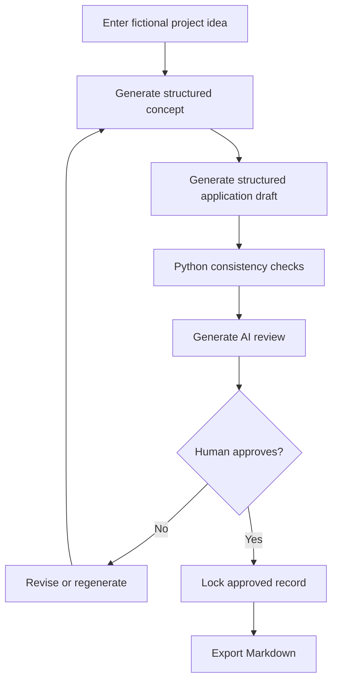

# PLANS.md — HankeLuotsi AI: implementation and acceptance plan

**Owner:** Tanja Kukkamäki | **Mode:** Individual HAMK AI Project  
**Estimated effort:** 135 hours (5 ECTS); **work begins:** initial planning in late October 2026  
**Course dates:** planning forum Sunday 8 November 2026, 12:00 (Finland time); working prototype 22 November 2026, 12:00; final delivery 13 December 2026, 12:00  
**Document version:** 1.1 — 7 November 2026 (planning deadline corrected)

> **Status:** Implementation plan, not a claim that the software or tests already exist. The Moodle forum post is the ≤500-word summary; this file contains the supporting details. Planned hours are estimates and must be tracked against actual hours.

## A. Goal and scope

**User problem:** Early EU project ideas are difficult to structure consistently. HankeLuotsi AI helps a project planner produce a transparent draft and find gaps for human correction.

**One end-to-end workflow:**



**Not an eligibility engine.** On-screen and exported documents must state that output is AI-generated and **not** an official assessment of funding compliance. Any examples involving cross-border cooperation are generic, not claims about specific programmes.

**Limits (do not expand):** one Streamlit app; no user accounts, budget tools, programme-specific forms, funding authority APIs, Word/PDF exports, autonomous multi-agent business workflows, or public deployment. English UI and sample output for the MVP.

**Owner-approved funding research exception (8 November 2026):** Read-only official funding-source research and local preliminary comparison are now authorized as the optional bounded task below. This does not authorize applications, eligibility verdicts, cloud AI, paid APIs or PR7. Existing concept PDF export is preserved by the owner's explicit instruction; this task does not change export behavior.

## B. What must be demonstrably working

| Milestone | Minimum demonstrable result | Due |
|---|---|---|
| Planning submission | ≤500-word forum answer; `AGENTS.md` and `PLANS.md` optional supporting attachments | **8 Nov, 12:00** |
| Local inference benchmark | Three independent stage benchmarks; documented model/config and cloud fallback choice | 16 Nov |
| **Prototype** | Enter a fictional idea → generate a **validated concept** with configured model → save/reload SQLite → handle errors without data loss. Short video/screenshots and tests | **22 Nov** |
| Feature-complete candidate | Idea → concept → draft → deterministic checks → AI review → human approval → Markdown export | 4 Dec (internal freeze) |
| Final | Tested app, evaluation on five scenarios, reproducible setup, demo and self-reflection | 13 Dec |

**Important sequencing clarification:** The **draft and AI review benchmark prompts** are run with representative fictional *fixed JSON fixtures* by 16 November. This does not require their complete UI screens to exist before 16 November. The 22 November prototype is a vertical slice, while the complete workflow is due in December. The prototype milestone does not promise an already complete application draft or AI review UI.

## C. Roles, delegation and evidence

| Actor | Responsibilities | Evidence |
|---|---|---|
| **Tanja (sole student and decision-maker)** | Requirements, scope, acceptance criteria, prompts/data review, model choice, testing, commits, evaluation, course submissions and own learning | Git history, checklists, development log, final explanation |
| **Codex (coding agent)** | Small scoped implementation tasks, proposed code changes, unit tests, failure diagnosis, documentation updates | Agent task log, diffs, tests and reviewed commits |
| **ChatGPT** | Explain concepts, review architecture, help formulate prompts and diagnose issues | Design notes; accepted/rejected suggestions |
| **Claude / Grok / Perplexity** | Independent planning or code review when useful; no automatic acceptance | Review summary with decisions |
| **Local/cloud LLM (runtime component)** | Generate concept, draft and qualitative review; never write DB/approve records | Versioned prompts, benchmark and output logs |

**Agent loop, used repeatedly:** Student defines success → Codex plans → owner approves scope → Codex codes → automated tests → agent fixes test failures → owner reviews and manually verifies → owner approves commit → log actual hours and decisions. No one-shot implementation of the entire project.

## D. Weekly schedule and effort accounting

| Week | Dates 2026 | Student's planned work | Delegated AI work | Core h | Reserve h | Total h |
|---|---|---|---|---:|---:|---:|
| 1 | 27 Oct–2 Nov | Scope, data entities, architecture, risk review | ChatGPT organizes design; independent review | 13 | 1 | **14** |
| 2 | 3–9 Nov | Planning forum, repo preparation, model shortlist, schemas, initial CLI proof | Codex scaffolds selected files/tests | 18 | 2 | **20** |
| 3 | 10–16 Nov | Model benchmarking and gate; concept prompts, client, SQLite | Codex adds mock tests, client adapter and storage | 18 | 2 | **20** |
| 4 | 17–23 Nov | Build/test prototype, UI, screenshots/video; submit by 22 Nov | Codex implements UI, fixes failures | 16 | 2 | **18** |
| 5 | 24–30 Nov | Draft generation, reference checks, controlled regeneration | Codex builds draft pipeline and check tests | 18 | **4** | **22** |
| 6 | 1–7 Dec | AI review, approval lock, Markdown export; feature freeze 4 Dec | Codex integrates workflow and tests | 19 | 3 | **22** |
| 7 | 8–13 Dec | Five-scenario evaluation, setup docs, final demo/report | Codex assists targeted fixes and documentation | 17 | 2 | **19** |
| | | | **Total** | **119** | **16** | **135** |

**Reserve rule:** The 16 reserve hours are included in the weekly totals, not extra hours. Prioritize the 4 h reserve in Week 5 for draft/consistency-check integration. If unused, reserve hours can support tests/documentation; record actual use separately. Planned dates are not claims of work already completed.

## E. Small delivery tasks (one agent task at a time)

These are **proposed** tasks/PRs, not existing pull requests. A task may span multiple sessions. Each task must be approved before the next one begins.

### PR0 — Repository hygiene, logging and course skeleton (Week 2)

**Files:** `README.md`, `AGENTS.md`, `PLANS.md`, `.gitignore`, `.env.example`, `docs/development_log.md`, `requirements.txt`.

**Codex:** propose structure, dependency list and commands. **Student:** decide folder names and inspect generated files.

**Acceptance:** A fresh Windows clone can create a Python virtual environment, install pinned/recorded dependencies and start the basic Streamlit shell; secrets and DB files are ignored. The development log records initial decisions. A README example uses fictional data.

### PR1 — Minimal schemas and sample fixtures (Week 2)

**Files:** `hankeluotsi/schemas.py`, `tests/test_schemas.py`, optional `tests/fixtures/`.

**Codex:** implement Pydantic models and validation tests. **Student:** define meaningful planning fields and confirm that output is realistic for EU project planning.

**Recommended bounds:** 2–3 objectives, 2–3 work packages, approximately 6 activities, linked results/indicators. Keep work-package and reference relationships explicit. Do not add a budget.

**Acceptance:** Valid fixtures parse; required blank fields and malformed IDs fail; unknown schema versions are rejected clearly. `pytest` passes offline.

### PR2 — Local LLM proof, provider adapter and versioned prompts (Weeks 2–3)

**Files:** `hankeluotsi/llm_client.py`, `hankeluotsi/config.py`, `hankeluotsi/prompts.py`, `tests/test_llm_client.py`.

**Codex:** implement an OpenAI-compatible adapter, response capture, config and mocked test cases. **Student:** start LM Studio manually, verify GPU/CPU settings, run first fictional idea.

**Acceptance:** Client can call an available local server; handles missing server, empty response, malformed JSON, wrong schema, truncated completion, timeout, and **no more than one repair retry**. The client cannot access SQLite. Prompt version is included in the result metadata. Secrets are never printed.

### PR3 — Reproducible three-stage model benchmark and decision (by 16 Nov)

**Files:** `docs/model_benchmark.md`, `tests/fixtures/benchmark/` and a small benchmark command/script.

**Codex:** implement a runner that performs **10 first attempts per stage**, saving structured results, not fabricated results. **Student:** select the candidates, actually run them on the laptop, review content, and sign off on stage-specific routing.

**Initial candidate (to verify):** Qwen3.5-4B GGUF Q4_K_M with 8192-token context; compare one locally available suitable model. A 6 GB GPU may require offloading or reduced context; record actual behavior, do not promise full GPU residency.

**For each attempt save:** date, stage, fictional fixture, prompt version, exact model identifier/GGUF hash or filename, quantization, context, generation parameters, runtime version, latency, completion reason, raw-JSON parsability, Pydantic validity, truncation and reviewer's basic content score.

**Gate:** ≥8/10 **first-attempt** valid, non-truncated Pydantic outputs separately for concept/draft/review. First attempts must not be quietly repaired for scoring. Concept ~90 s and draft ~180 s are *targets*, not hard pass thresholds. If a stage is unreliable or too slow, record the decision and map only that stage to a configured cloud provider **for fictional data**. Retest fallback success on the same fixed fixtures. Costs are distinct from any ChatGPT subscription.

### PR4 — SQLite repository and state-machine tests (Weeks 3–4)

**Files:** `hankeluotsi/repository.py`, `tests/test_repository.py`.

**Codex:** implement table schema, transactions, state checks and repository tests. **Student:** verify state semantics and inspect SQLite contents using fictional records.

**Acceptance:** Create/load work; invalid outputs never overwrite valid data; concept regeneration atomically removes downstream draft/review and resets status; approved records cannot be edited; export is blocked until approval; repeat submissions do not create duplicates. Explicit errors are raised for invalid transitions.

### PR5 — Usable Streamlit prototype vertical slice (Week 4, by 22 Nov)

**Files:** `app.py`, `hankeluotsi/pipeline.py`, `tests/test_app.py`.

**Codex:** implement idea form, concept button, loading/errors, persistence, read-back and tests. **Student:** verify the UI works and record a demo.

**Acceptance:** A fictional idea generates a **validated concept**, saves with `concept_ready`, reopens after app restart, and shows a useful error if the model is missing. The app never regenerates just because Streamlit reruns. UI uses mocked LLM in AppTest; repository/service tests cover duplicate requests. Submit the course prototype and evidence by **22 Nov 12:00**.

### PR6 — Draft and deterministic consistency checker (Week 5)

**Files:** `hankeluotsi/consistency.py`, `hankeluotsi/pipeline.py`, `tests/test_consistency.py`, `tests/test_pipeline.py`.

**Codex:** generate a short linked draft; implement pure Python finding codes and cross-reference tests. **Student:** judge whether objectives, activities, results, indicators and partner roles form a meaningful narrative.

**Acceptance:** Valid draft enters `draft_ready`; invalid references are detected deterministically; findings distinguish missing references from advisory content concerns; regeneration invalidates later results.

### PR7 — AI review, human approval and Markdown export (Week 6)

**Files:** `hankeluotsi/pipeline.py`, `hankeluotsi/exporter.py`, tests and UI updates.

**Codex:** implement AI review using checks as context, explicit approval and export. **Student:** review what the AI claims and test the consent/approval flow.

**Acceptance:** `reviewed` status requires a saved review; only a **human action** changes it to `approved`; approved content remains immutable; Markdown export includes the funding disclaimer, project details and human-approved draft. Export cannot execute generated content.

### PR8 — Resilience, evaluation and final documentation (Weeks 6–7)

**Files:** `docs/evaluation.md`, `README.md`, test files, demo files (as appropriate), final report.

**Codex:** suggest limited fixes and create test cases. **Student:** preregister evaluation criteria, run five synthetic scenarios, score independently and write reflection.

**Acceptance:** Four of five scenarios complete the full pipeline. Report scores across four criteria (1–5), failures, limitations, latency, model/provider versions, actual hours and what was delegated to agents. README lets the teacher reproduce what is feasible or view a recorded demonstration. **Feature freeze 4 Dec**, except for bug fixes and documentation.

### Optional task — Funding Opportunities Research, first limited slice (approved 8 Nov)

**Files:** `hankeluotsi/funding.py`, `app.py`, `tests/test_funding.py`, `tests/test_funding_app.py`, `README.md`, `AGENTS.md`, this plan, `docs/funding_sources.md`, `docs/development_log.md`. No existing prompts, project schemas, repository, PDF exporter or dependencies change.

**Contract:** Separate frozen Pydantic `FundingOpportunity` records, schema version 1: record ID, funding programme, explicit `programme_guidance` record kind, optional call title, objectives/priorities, geographic scope, applicant guidance, optional application dates, `open`/`closed`/`unknown` status, official source URL and evidence URLs, general-guidance verification date, optional live-page retrieval timestamp/URL/excerpt, retrieval state and uncertainties. For this slice all call titles and dates are null and statuses unknown; programme descriptions cannot establish an open call. No project data or funding results are added to SQLite.

**Research decision:** Investigate all four official source families. The Portal documents an API, but a reliable filtered response could not be verified in bounded live checks. EURA public calls require JavaScript. Use six reviewed programme profiles (three EURA funds plus Aurora, Portal and Business Finland). Optional network retrieval reads page titles/descriptions only from four fixed official URLs, with timeouts, size limits, TLS validation and no redirects/retries. It never updates call facts or the reviewed programme summaries. Failures preserve the guide with an honest unavailable message. Sources and limitations are recorded in `docs/funding_sources.md`.

**Acceptance:**
- Funding research requires an explicit form submission for a saved idea, including an idea without a concept. Online page retrieval is opt-in; offline guidance is always usable.
- All profiles show official links, general-guidance verification dates, unknown call details, uncertainty and live-page retrieval dates only when usable descriptions were actually fetched.
- A small documented English/Finnish topic vocabulary produces local research clues, without eligibility classifications or numeric fit scores. Geography and applicant conditions remain manual checks.
- Reruns do not repeat requests. Results are temporary session display data keyed to the saved project/idea and cannot change project content, approval, generation, PDF export or consistency results.
- Mocked offline logic and AppTests cover failures, privacy, reruns, source evidence and saved-record preservation; the complete offline suite passes. Live source checks are separate from pytest.
- No commits, pushes, merges or PR7. Owner reviews the diff and limitations before any next task.

### Optional task — Live Funding Search (approved 8 Nov, after funding research commit)

**Baseline:** Clean `3a26045`; separate `feature/live-funding-search` branch. Preserve project data and all existing functionality. No commits, pushes, merges or unrelated phases.

**Files:** New `hankeluotsi/funding_calls.py` (separate call models, date/status and local comparison), `hankeluotsi/funding_eu.py` (verified API adapter), `hankeluotsi/live_funding.py` (Aurora CSV and search orchestration), fictional fixtures/tests, optional integration check; additive `app.py` integration; README, agent instructions, this plan and source/development documentation. Existing project schemas, prompts and repository remain unchanged.

**Contract:** Frozen version-1 `FundingCall` records contain source, programme, official identifier/title, optional parent call identifier, objective/geographic/applicant source text, optional opening/deadline with raw values and explicit date/time precision, official status, official page/evidence URLs, retrieval timestamp, optional source update date and uncertainties. `LiveSearchResult` separates calls from source notices/partial-result warnings. A date-only field is never displayed as a precise deadline time. Missing/invalid dates, conflicts, boundary ambiguity and stale snapshots produce unknown statuses with explanations. No funding records are persisted in SQLite.

**Source gates:** Aurora's calls page links its current semicolon-delimited Windows-1252 CSV with observed column names, real identifiers and ISO dates. Discover that official link each search; do not guess dated dataset paths. The EU Portal's documented multipart API has been verified using JSON file parts for `query` and `languages`; filter grant topics to Horizon Europe with fixed requests and bounded pages. Validate returned source/type/programme/language/URLs and reject unexpected contracts. Other sources remain explicitly labelled guidance/unavailable until independently integrated.

**Acceptance:** Explicit **Search Live Funding Calls** action on a saved idea; no automatic network requests on reruns; project text never enters requests; evidence-backed live calls are distinct from general suggestions. Display actual IDs/title/objectives, available geography/applicants, raw/parsed dates, official and conservative current status, evidence URLs, retrieval/update dates and uncertainty. Explain local vocabulary overlaps without eligibility scores. Failures isolate sources, partial pagination stays visible, and stale session snapshots require explicit refresh. Offline fictional fixtures test dates/time zones/statuses, provenance, malformed/partial responses and UI preservation; opt-in live checks never run in the default suite. Complete offline tests and whitespace checks pass; document verified results and limits.

## F. Evaluation rubric (write before scenario execution)

Score each dimension **1–5** and record short evidence; these are educational judgments, not objective funding eligibility scores.

| Dimension | 1 = weak | 3 = adequate | 5 = strong |
|---|---|---|---|
| Completeness | Major required content missing | Most required sections present, some gaps | All MVP sections substantive and clearly linked |
| Coherence | Contradictory goals, tasks or outputs | Mostly coherent, some vague links | Clear need → objectives → activities → results narrative |
| Indicator quality | Unmeasurable or unrelated | Partly measurable but weak evidence of change | Measurable result-aligned indicator, e.g. demonstrated skills rather than attendance alone |
| Review usefulness | Generic praise or unsupported rules | Some actionable findings | Specific, accurate, prioritised gaps with clear improvement suggestions |

**Five scenarios:** SME AI training; Finnish–Swedish creative-industry cooperation; sustainable tourism service improvement; regional skills development; creative-sector innovation. Use fictional names/figures. A **successful workflow** completes all stages, validates stored structures, receives human approval and produces the intended Markdown file without corrupting data. The score table is reported separately; success is **≥4/5 completed workflows** (not a claim that each criterion automatically deserves 5/5).

## G. Testing, quality and safety gates

1. **Default offline suite:** `python -m pytest -q`; replace model responses with mocks. No live services are needed for default tests.
2. **Streamlit AppTest:** use an explicit default timeout, e.g. `AppTest.from_file("app.py", default_timeout=10)`. Test widget and page flows only; do not misrepresent AppTest as a way to simulate clicks while streaming.
3. **Service/database tests:** duplicate-submit protection, transaction rollbacks, invalid transitions, concurrency/idempotency safeguards and approval lock.
4. **Manual local integration:** LM Studio server available on localhost; note actual model, speed, structured-output support and context settings.
5. **Cloud fallback:** no non-fictional data; no secret or billing information in commits; handle missing API key gracefully.
6. **Human checkpoints:** every coding task requires a reviewable diff, tests and student approval before commit; failures must be logged.
7. **Truthfulness:** generated text is untrusted draft material. Never represent suggestions as programme rules or the system as a funding authority.

## H. Risks, responses and owner decision points

| Risk / trigger | Prevention or response | Owner decision |
|---|---|---|
| Local model fails 16 Nov gate | Measure all three stages, then choose per-stage cloud fallback | Select provider or reduce scope; record cost/privacy constraints |
| 6 GB VRAM / truncated draft | Small quantized model, bounded output, simpler schema, context reduction and offload tests | Keep draft manageable; never silently accept incomplete output |
| Scope expands | Enforce `AGENTS.md` exclusions and task acceptance criteria | Reject unplanned features |
| Streamlit rerun creates duplicate generation | Explicit submissions, stable guards, DB transactions | Inspect tests and repeated-click behavior |
| AI-generated code is wrong | Tests, small commits, owner reviews | Approve/rollback each step |
| Programme rules are invented | Generic assistance only; uncertainty, disclaimer and human approval | Reject unsupported compliance claims |
| Confidential or personal data leaks | Fictional input only; localhost; `.env` ignored; no real partner data | Stop and clean data before any sharing |
| Deadline pressure | Prototype-first, 4 Dec feature freeze, 16 hours reserved | Prioritise reliable vertical slice and evidence |

## I. Reproducibility and final documentation checklist

- [ ] 500-word Moodle forum plan submitted by its deadline.
- [ ] `AGENTS.md` and `PLANS.md` attached if desired; no claim they are already implemented.
- [ ] Repository created with owner-approved initial files.
- [ ] README includes Windows setup, install commands, local LM Studio start, configuration and app launch.
- [ ] Exact working local model name, GGUF artifact, quantization, context, GPU settings, prompt version and runtime version documented after tests.
- [ ] Benchmark and 16 Nov decisions recorded for all three stages.
- [ ] Prototype evidence submitted by 22 Nov.
- [ ] Default pytest suite runs offline with a mocked model.
- [ ] Application never submits to a funding authority or claims eligibility verification.
- [ ] Approved record is protected and export contains disclaimer.
- [ ] Evaluation rubric and fictional cases fixed before final scoring.
- [ ] Five evaluations, screenshots/video and limitations recorded.
- [ ] Actual 135-hour log (or variance) and AI agent contribution history reported honestly.
- [ ] Final delivery complete by 13 Dec 2026, 12:00.

## J. Agent task template (copy for each Codex task)

```markdown
### Task ID and title
**User value:**
**Files permitted to change:**
**Inputs and existing contracts:**
**Acceptance criteria (testable):**
**Out of scope:**
**Tests to run:**
**Owner review required before commit:** yes
**Outcome / commands and results:**
**Actual student time:**
**Agent prompts / prompt version:**
**Difficulties and corrections:**
```

**Next session (Saturday 7 November):** Confirm repo location and installed Python/VS Code/Git, create the minimal skeleton, put these two Markdown files into the repository root, prepare a fictional idea fixture, and implement **PR0 followed by PR1**. Do not jump to the complete UI before defining and testing the schemas.
