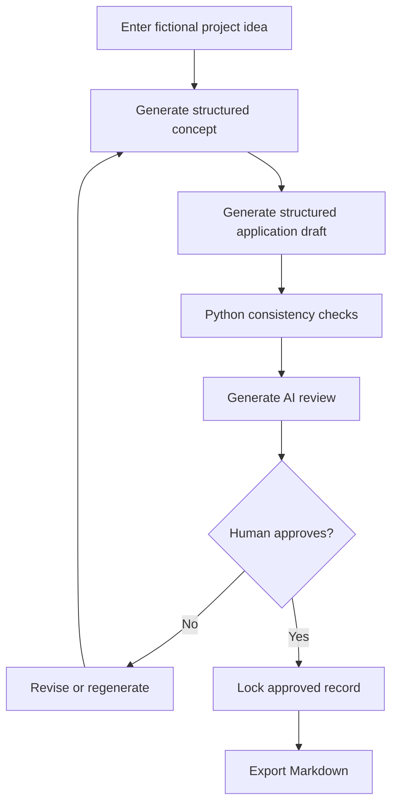

# PLANS.md — HankeLuotsi AI: implementation and acceptance plan

**Owner:** Tanja Kukkamäki | **Mode:** Individual HAMK AI Project  
**Estimated effort:** 135 hours (5 ECTS); **work begins:** initial planning in late October 2026  
**Course dates:** planning forum Sunday 8 November 2026, 12:00 (Finland time); working prototype 22 November 2026, 12:00; final delivery 13 December 2026, 12:00  
**Document version:** 1.1 — 7 November 2026 (planning deadline corrected)

> **Status:** Implementation plan, not a claim that the software or tests already exist. The Moodle forum post is the ≤500-word summary; this file contains the supporting details. Planned hours are estimates and must be tracked against actual hours.

## A. Goal and scope

**User problem:** Early EU project ideas are difficult to structure consistently. HankeLuotsi AI helps a project planner produce a transparent draft and find gaps for human correction.

**One end-to-end workflow:**



**Not an eligibility engine.** On-screen and exported documents must state that output is AI-generated and **not** an official assessment of funding compliance. Any examples involving cross-border cooperation are generic, not claims about specific programmes.

**Limits (do not expand):** one Streamlit app; no user accounts, budget tools, programme-specific forms, funding authority APIs, Word/PDF exports, autonomous multi-agent business workflows, or public deployment. English UI and sample output for the MVP.

**Owner-approved funding research exception (8 November 2026):** Read-only official funding-source research and local preliminary comparison are now authorized as the optional bounded task below. This does not authorize applications, eligibility verdicts, cloud AI, paid APIs or PR7. Existing concept PDF export is preserved by the owner's explicit instruction; this task does not change export behavior.

## B. What must be demonstrably working

| Milestone | Minimum demonstrable result | Due |
|---|---|---|
| Planning submission | ≤500-word forum answer; `AGENTS.md` and `PLANS.md` optional supporting attachments | **8 Nov, 12:00** |
| Local inference benchmark | Three independent stage benchmarks; documented model/config and cloud fallback choice | 16 Nov |
| **Prototype** | Enter a fictional idea → generate a **validated concept** with configured model → save/reload SQLite → handle errors without data loss. Short video/screenshots and tests | **22 Nov** |
| Feature-complete candidate | Idea → concept → draft → deterministic checks → AI review → human approval → Markdown export | 4 Dec (internal freeze) |
| Final | Tested app, evaluation on five scenarios, reproducible setup, demo and self-reflection | 13 Dec |

**Important sequencing clarification:** The **draft and AI review benchmark prompts** are run with representative fictional *fixed JSON fixtures* by 16 November. This does not require their complete UI screens to exist before 16 November. The 22 November prototype is a vertical slice, while the complete workflow is due in December. The prototype milestone does not promise an already complete application draft or AI review UI.

## C. Roles, delegation and evidence

| Actor | Responsibilities | Evidence |
|---|---|---|
| **Tanja (sole student and decision-maker)** | Requirements, scope, acceptance criteria, prompts/data review, model choice, testing, commits, evaluation, course submissions and own learning | Git history, checklists, development log, final explanation |
| **Codex (coding agent)** | Small scoped implementation tasks, proposed code changes, unit tests, failure diagnosis, documentation updates | Agent task log, diffs, tests and reviewed commits |
| **ChatGPT** | Explain concepts, review architecture, help formulate prompts and diagnose issues | Design notes; accepted/rejected suggestions |
| **Claude / Grok / Perplexity** | Independent planning or code review when useful; no automatic acceptance | Review summary with decisions |
| **Local/cloud LLM (runtime component)** | Generate concept, draft and qualitative review; never write DB/approve records | Versioned prompts, benchmark and output logs |

**Agent loop, used repeatedly:** Student defines success → Codex plans → owner approves scope → Codex codes → automated tests → agent fixes test failures → owner reviews and manually verifies → owner approves commit → log actual hours and decisions. No one-shot implementation of the entire project.

## D. Weekly schedule and effort accounting

| Week | Dates 2026 | Student's planned work | Delegated AI work | Core h | Reserve h | Total h |
|---|---|---|---|---:|---:|---:|
| 1 | 27 Oct–2 Nov | Scope, data entities, architecture, risk review | ChatGPT organizes design; independent review | 13 | 1 | **14** |
| 2 | 3–9 Nov | Planning forum, repo preparation, model shortlist, schemas, initial CLI proof | Codex scaffolds selected files/tests | 18 | 2 | **20** |
| 3 | 10–16 Nov | Model benchmarking and gate; concept prompts, client, SQLite | Codex adds mock tests, client adapter and storage | 18 | 2 | **20** |
| 4 | 17–23 Nov | Build/test prototype, UI, screenshots/video; submit by 22 Nov | Codex implements UI, fixes failures | 16 | 2 | **18** |
| 5 | 24–30 Nov | Draft generation, reference checks, controlled regeneration | Codex builds draft pipeline and check tests | 18 | **4** | **22** |
| 6 | 1–7 Dec | AI review, approval lock, Markdown export; feature freeze 4 Dec | Codex integrates workflow and tests | 19 | 3 | **22** |
| 7 | 8–13 Dec | Five-scenario evaluation, setup docs, final demo/report | Codex assists targeted fixes and documentation | 17 | 2 | **19** |
| | | | **Total** | **119** | **16** | **135** |

**Reserve rule:** The 16 reserve hours are included in the weekly totals, not extra hours. Prioritize the 4 h reserve in Week 5 for draft/consistency-check integration. If unused, reserve hours can support tests/documentation; record actual use separately. Planned dates are not claims of work already completed.

## E. Small delivery tasks (one agent task at a time)

These are **proposed** tasks/PRs, not existing pull requests. A task may span multiple sessions. Each task must be approved before the next one begins.

### PR0 — Repository hygiene, logging and course skeleton (Week 2)

**Files:** `README.md`, `AGENTS.md`, `PLANS.md`, `.gitignore`, `.env.example`, `docs/development_log.md`, `requirements.txt`.

**Codex:** propose structure, dependency list and commands. **Student:** decide folder names and inspect generated files.

**Acceptance:** A fresh Windows clone can create a Python virtual environment, install pinned/recorded dependencies and start the basic Streamlit shell; secrets and DB files are ignored. The development log records initial decisions. A README example uses fictional data.

### PR1 — Minimal schemas and sample fixtures (Week 2)

**Files:** `hankeluotsi/schemas.py`, `tests/test_schemas.py`, optional `tests/fixtures/`.

**Codex:** implement Pydantic models and validation tests. **Student:** define meaningful planning fields and confirm that output is realistic for EU project planning.

**Recommended bounds:** 2–3 objectives, 2–3 work packages, approximately 6 activities, linked results/indicators. Keep work-package and reference relationships explicit. Do not add a budget.

**Acceptance:** Valid fixtures parse; required blank fields and malformed IDs fail; unknown schema versions are rejected clearly. `pytest` passes offline.

### PR2 — Local LLM proof, provider adapter and versioned prompts (Weeks 2–3)

**Files:** `hankeluotsi/llm_client.py`, `hankeluotsi/config.py`, `hankeluotsi/prompts.py`, `tests/test_llm_client.py`.

**Codex:** implement an OpenAI-compatible adapter, response capture, config and mocked test cases. **Student:** start LM Studio manually, verify GPU/CPU settings, run first fictional idea.

**Acceptance:** Client can call an available local server; handles missing server, empty response, malformed JSON, wrong schema, truncated completion, timeout, and **no more than one repair retry**. The client cannot access SQLite. Prompt version is included in the result metadata. Secrets are never printed.

### PR3 — Reproducible three-stage model benchmark and decision (by 16 Nov)

**Files:** `docs/model_benchmark.md`, `tests/fixtures/benchmark/` and a small benchmark command/script.

**Codex:** implement a runner that performs **10 first attempts per stage**, saving structured results, not fabricated results. **Student:** select the candidates, actually run them on the laptop, review content, and sign off on stage-specific routing.

**Initial candidate (to verify):** Qwen3.5-4B GGUF Q4_K_M with 8192-token context; compare one locally available suitable model. A 6 GB GPU may require offloading or reduced context; record actual behavior, do not promise full GPU residency.

**For each attempt save:** date, stage, fictional fixture, prompt version, exact model identifier/GGUF hash or filename, quantization, context, generation parameters, runtime version, latency, completion reason, raw-JSON parsability, Pydantic validity, truncation and reviewer's basic content score.

**Gate:** ≥8/10 **first-attempt** valid, non-truncated Pydantic outputs separately for concept/draft/review. First attempts must not be quietly repaired for scoring. Concept ~90 s and draft ~180 s are *targets*, not hard pass thresholds. If a stage is unreliable or too slow, record the decision and map only that stage to a configured cloud provider **for fictional data**. Retest fallback success on the same fixed fixtures. Costs are distinct from any ChatGPT subscription.

### PR4 — SQLite repository and state-machine tests (Weeks 3–4)

**Files:** `hankeluotsi/repository.py`, `tests/test_repository.py`.

**Codex:** implement table schema, transactions, state checks and repository tests. **Student:** verify state semantics and inspect SQLite contents using fictional records.

**Acceptance:** Create/load work; invalid outputs never overwrite valid data; concept regeneration atomically removes downstream draft/review and resets status; approved records cannot be edited; export is blocked until approval; repeat submissions do not create duplicates. Explicit errors are raised for invalid transitions.

### PR5 — Usable Streamlit prototype vertical slice (Week 4, by 22 Nov)

**Files:** `app.py`, `hankeluotsi/pipeline.py`, `tests/test_app.py`.

**Codex:** implement idea form, concept button, loading/errors, persistence, read-back and tests. **Student:** verify the UI works and record a demo.

**Acceptance:** A fictional idea generates a **validated concept**, saves with `concept_ready`, reopens after app restart, and shows a useful error if the model is missing. The app never regenerates just because Streamlit reruns. UI uses mocked LLM in AppTest; repository/service tests cover duplicate requests. Submit the course prototype and evidence by **22 Nov 12:00**.

### PR6 — Draft and deterministic consistency checker (Week 5)

**Files:** `hankeluotsi/consistency.py`, `hankeluotsi/pipeline.py`, `tests/test_consistency.py`, `tests/test_pipeline.py`.

**Codex:** generate a short linked draft; implement pure Python finding codes and cross-reference tests. **Student:** judge whether objectives, activities, results, indicators and partner roles form a meaningful narrative.

**Acceptance:** Valid draft enters `draft_ready`; invalid references are detected deterministically; findings distinguish missing references from advisory content concerns; regeneration invalidates later results.

### PR7 — AI review, human approval and Markdown export (Week 6)

**Files:** `hankeluotsi/pipeline.py`, `hankeluotsi/exporter.py`, tests and UI updates.

**Codex:** implement AI review using checks as context, explicit approval and export. **Student:** review what the AI claims and test the consent/approval flow.

**Acceptance:** `reviewed` status requires a saved review; only a **human action** changes it to `approved`; approved content remains immutable; Markdown export includes the funding disclaimer, project details and human-approved draft. Export cannot execute generated content.

### PR8 — Resilience, evaluation and final documentation (Weeks 6–7)

**Files:** `docs/evaluation.md`, `README.md`, test files, demo files (as appropriate), final report.

**Codex:** suggest limited fixes and create test cases. **Student:** preregister evaluation criteria, run five synthetic scenarios, score independently and write reflection.

**Acceptance:** Four of five scenarios complete the full pipeline. Report scores across four criteria (1–5), failures, limitations, latency, model/provider versions, actual hours and what was delegated to agents. README lets the teacher reproduce what is feasible or view a recorded demonstration. **Feature freeze 4 Dec**, except for bug fixes and documentation.

### Optional task — Funding Opportunities Research, first limited slice (approved 8 Nov)

**Files:** `hankeluotsi/funding.py`, `app.py`, `tests/test_funding.py`, `tests/test_funding_app.py`, `README.md`, `AGENTS.md`, this plan, `docs/funding_sources.md`, `docs/development_log.md`. No existing prompts, project schemas, repository, PDF exporter or dependencies change.

**Contract:** Separate frozen Pydantic `FundingOpportunity` records, schema version 1: record ID, funding programme, explicit `programme_guidance` record kind, optional call title, objectives/priorities, geographic scope, applicant guidance, optional application dates, `open`/`closed`/`unknown` status, official source URL and evidence URLs, general-guidance verification date, optional live-page retrieval timestamp/URL/excerpt, retrieval state and uncertainties. For this slice all call titles and dates are null and statuses unknown; programme descriptions cannot establish an open call. No project data or funding results are added to SQLite.

**Research decision:** Investigate all four official source families. The Portal documents an API, but a reliable filtered response could not be verified in bounded live checks. EURA public calls require JavaScript. Use six reviewed programme profiles (three EURA funds plus Aurora, Portal and Business Finland). Optional network retrieval reads page titles/descriptions only from four fixed official URLs, with timeouts, size limits, TLS validation and no redirects/retries. It never updates call facts or the reviewed programme summaries. Failures preserve the guide with an honest unavailable message. Sources and limitations are recorded in `docs/funding_sources.md`.

**Acceptance:**
- Funding research requires an explicit form submission for a saved idea, including an idea without a concept. Online page retrieval is opt-in; offline guidance is always usable.
- All profiles show official links, general-guidance verification dates, unknown call details, uncertainty and live-page retrieval dates only when usable descriptions were actually fetched.
- A small documented English/Finnish topic vocabulary produces local research clues, without eligibility classifications or numeric fit scores. Geography and applicant conditions remain manual checks.
- Reruns do not repeat requests. Results are temporary session display data keyed to the saved project/idea and cannot change project content, approval, generation, PDF export or consistency results.
- Mocked offline logic and AppTests cover failures, privacy, reruns, source evidence and saved-record preservation; the complete offline suite passes. Live source checks are separate from pytest.
- No commits, pushes, merges or PR7. Owner reviews the diff and limitations before any next task.

### Optional task — Live Funding Search (approved 8 Nov, after funding research commit)

**Baseline:** Clean `3a26045`; separate `feature/live-funding-search` branch. Preserve project data and all existing functionality. No commits, pushes, merges or unrelated phases.

**Files:** New `hankeluotsi/funding_calls.py` (separate call models, date/status and local comparison), `hankeluotsi/funding_eu.py` (verified API adapter), `hankeluotsi/live_funding.py` (Aurora CSV and search orchestration), fictional fixtures/tests, optional integration check; additive `app.py` integration; README, agent instructions, this plan and source/development documentation. Existing project schemas, prompts and repository remain unchanged.

**Contract:** Frozen version-1 `FundingCall` records contain source, programme, official identifier/title, optional parent call identifier, objective/geographic/applicant source text, optional opening/deadline with raw values and explicit date/time precision, official status, official page/evidence URLs, retrieval timestamp, optional source update date and uncertainties. `LiveSearchResult` separates calls from source notices/partial-result warnings. A date-only field is never displayed as a precise deadline time. Missing/invalid dates, conflicts, boundary ambiguity and stale snapshots produce unknown statuses with explanations. No funding records are persisted in SQLite.

**Source gates:** Aurora's calls page links its current semicolon-delimited Windows-1252 CSV with observed column names, real identifiers and ISO dates. Discover that official link each search; do not guess dated dataset paths. The EU Portal's documented multipart API has been verified using JSON file parts for `query` and `languages`; filter grant topics to Horizon Europe with fixed requests and bounded pages. Validate returned source/type/programme/language/URLs and reject unexpected contracts. Other sources remain explicitly labelled guidance/unavailable until independently integrated.

**Acceptance:** Explicit **Search Live Funding Calls** action on a saved idea; no automatic network requests on reruns; project text never enters requests; evidence-backed live calls are distinct from general suggestions. Display actual IDs/title/objectives, available geography/applicants, raw/parsed dates, official and conservative current status, evidence URLs, retrieval/update dates and uncertainty. Explain local vocabulary overlaps without eligibility scores. Failures isolate sources, partial pagination stays visible, and stale session snapshots require explicit refresh. Offline fictional fixtures test dates/time zones/statuses, provenance, malformed/partial responses and UI preservation; opt-in live checks never run in the default suite. Complete offline tests and whitespace checks pass; document verified results and limits.

### UI polish and end-to-end QA continuation (approved 8–9 Nov)

**Scope:** Continue the existing redesign and original SVG assets on the current branch; preserve owner commits/staging and Live Funding Search. Native Streamlit layout, local CSS/theme, escaped display helpers, compact concept/funding cards and responsive navigation only. Small reproducible UI/path/selection fixes are authorized; project schemas, AI prompts, repository and verified funding logic stay unchanged. No PR7, dependencies, external design services or Git history actions.

**Files:** `app.py`, `hankeluotsi/presentation.py`, local `assets/`, `.streamlit/config.toml`, focused UI tests, README, this plan and QA/development documentation. Preserve original SVG files unless an actual rendering defect requires adjustment.

**Acceptance:** Full offline suite; real-browser fictional-data checks for generation where LM Studio is available, save/reopen, concept/consistency, PDF/Finnish characters, programme guidance, live calls/links and source failures. Verify desktop/tablet/mobile geometry, safe collapsed content, readable contrast, preserved approved records and the normal database. Record unavailable checks honestly. `docs/ui_qa.md` contains review evidence and a manual checklist. Owner review precedes any commit.

### Intelligent funding matching and ranking (approved 9 Nov)

**Scope / files:** Separate pure `hankeluotsi/funding_matching.py`, additive live-results UI in `app.py`, fictional matching/AppTest regressions, README and matching/development documentation. Stay on the current feature branch and preserve existing work. No project-schema, prompt, repository, PDF, model-provider or source-adapter changes; no paid services, PR7 or Git publication.

**Contract:** Immutable derived match assessments reference the original call records. Use saved title/need/expected change/target groups, optional concept objectives, geography and explicit partner-type wording locally. Transparent weighted theme coverage dominates small geography/applicant-context clues. High/Medium/Low/Insufficient Information, evidence confidence and explanations are separate from current call status and eligibility. Missing applicant/location data cannot establish compatibility. Validate official URL/identifier/evidence relationships using the existing adapter contracts; unconfirmed records remain unscored with unknown current status.

**Acceptance:** Specific creative/community/skills evidence ranks before unrelated scientific calls; broad research/digital words and non-art phrases alone do not promote calls. Default relevance order with programme/status/relevance filters retains access to all results. Source facts stay unchanged, conflicts/staleness retain conservative statuses, filters/reruns make no external calls, and no project text enters retrieval. Offline fictional tests include missing/excluded/ambiguous information, source failures, date conflicts and saved-record preservation. Verify raw official data separately and inspect the actual Streamlit interface. Complete offline suite, `git diff --check`, documented limitations and owner review before any commit.

### Final ConceptPaper PDF pagination polish (approved 9 Nov)

**Files / scope:** `hankeluotsi/pdf_exporter.py`, PDF pagination tests, this plan and development log, plus two fictional review PDFs. Moderate spacing reductions only; keep the existing 9-point body/12-point leading, A4 margins, Unicode fonts, source content/IDs, disclaimer and page numbers. Group each ordinary indicator with its measurement label/text; allow a block larger than a full page to split safely.

**Acceptance:** A representative near-one-page fixture fits on one page without font shrinking; page-boundary tests keep each fitting indicator/measurement together; longer documents and oversized paragraphs paginate without loss/overflow. Generate and visually inspect fictional one- and two-page PDFs. Complete offline suite and whitespace checks pass. Preserve schemas, prompts, SQLite, funding, UI and other functionality; no dependency or Git publication changes. Owner reviews before committing.

### Finnish / English interface and concept generation (approved 11 Nov)

**Scope / files:** Central `hankeluotsi/i18n.py`, application/presentation labels and a top-right Suomi/English selector, minimal per-request output-language instruction in the existing concept input, localized PDF labels, focused CSS, fictional fixtures/tests and documentation. Preserve the staged PDF-layout work and Git index. No schema, repository, stored-record, funding-rule/adapter, provider or base prompt-template changes; no cloud translation, dependencies or Git publication.

**Contract / acceptance:** Interface language lives only in Streamlit session state. Locale-specific dropdown widgets carry canonical selections across switches, retaining project IDs and cached call/filter values without source/model requests. Saved text and official funding source excerpts remain original. New generation requests selected-language human text with unchanged JSON keys, schema version and O/A/R/I IDs, using the existing local client and strict validation. PDF headings/disclaimer/footer follow the chosen interface language; body text is preserved. Both locales, switching, approved-record preservation, invalid model keys, cached funding and PDF rendering pass offline tests; verify both in a real browser, including mobile selector visibility. Preserve all staged changes and report limitations before owner review.

## F. Evaluation rubric (write before scenario execution)

Score each dimension **1–5** and record short evidence; these are educational judgments, not objective funding eligibility scores.

| Dimension | 1 = weak | 3 = adequate | 5 = strong |
|---|---|---|---|
| Completeness | Major required content missing | Most required sections present, some gaps | All MVP sections substantive and clearly linked |
| Coherence | Contradictory goals, tasks or outputs | Mostly coherent, some vague links | Clear need → objectives → activities → results narrative |
| Indicator quality | Unmeasurable or unrelated | Partly measurable but weak evidence of change | Measurable result-aligned indicator, e.g. demonstrated skills rather than attendance alone |
| Review usefulness | Generic praise or unsupported rules | Some actionable findings | Specific, accurate, prioritised gaps with clear improvement suggestions |

**Five scenarios:** SME AI training; Finnish–Swedish creative-industry cooperation; sustainable tourism service improvement; regional skills development; creative-sector innovation. Use fictional names/figures. A **successful workflow** completes all stages, validates stored structures, receives human approval and produces the intended Markdown file without corrupting data. The score table is reported separately; success is **≥4/5 completed workflows** (not a claim that each criterion automatically deserves 5/5).

## G. Testing, quality and safety gates

1. **Default offline suite:** `python -m pytest -q`; replace model responses with mocks. No live services are needed for default tests.
2. **Streamlit AppTest:** use an explicit default timeout, e.g. `AppTest.from_file("app.py", default_timeout=10)`. Test widget and page flows only; do not misrepresent AppTest as a way to simulate clicks while streaming.
3. **Service/database tests:** duplicate-submit protection, transaction rollbacks, invalid transitions, concurrency/idempotency safeguards and approval lock.
4. **Manual local integration:** LM Studio server available on localhost; note actual model, speed, structured-output support and context settings.
5. **Cloud fallback:** no non-fictional data; no secret or billing information in commits; handle missing API key gracefully.
6. **Human checkpoints:** every coding task requires a reviewable diff, tests and student approval before commit; failures must be logged.
7. **Truthfulness:** generated text is untrusted draft material. Never represent suggestions as programme rules or the system as a funding authority.

## H. Risks, responses and owner decision points

| Risk / trigger | Prevention or response | Owner decision |
|---|---|---|
| Local model fails 16 Nov gate | Measure all three stages, then choose per-stage cloud fallback | Select provider or reduce scope; record cost/privacy constraints |
| 6 GB VRAM / truncated draft | Small quantized model, bounded output, simpler schema, context reduction and offload tests | Keep draft manageable; never silently accept incomplete output |
| Scope expands | Enforce `AGENTS.md` exclusions and task acceptance criteria | Reject unplanned features |
| Streamlit rerun creates duplicate generation | Explicit submissions, stable guards, DB transactions | Inspect tests and repeated-click behavior |
| AI-generated code is wrong | Tests, small commits, owner reviews | Approve/rollback each step |
| Programme rules are invented | Generic assistance only; uncertainty, disclaimer and human approval | Reject unsupported compliance claims |
| Confidential or personal data leaks | Fictional input only; localhost; `.env` ignored; no real partner data | Stop and clean data before any sharing |
| Deadline pressure | Prototype-first, 4 Dec feature freeze, 16 hours reserved | Prioritise reliable vertical slice and evidence |

## I. Reproducibility and final documentation checklist

- [ ] 500-word Moodle forum plan submitted by its deadline.
- [ ] `AGENTS.md` and `PLANS.md` attached if desired; no claim they are already implemented.
- [ ] Repository created with owner-approved initial files.
- [ ] README includes Windows setup, install commands, local LM Studio start, configuration and app launch.
- [ ] Exact working local model name, GGUF artifact, quantization, context, GPU settings, prompt version and runtime version documented after tests.
- [ ] Benchmark and 16 Nov decisions recorded for all three stages.
- [ ] Prototype evidence submitted by 22 Nov.
- [ ] Default pytest suite runs offline with a mocked model.
- [ ] Application never submits to a funding authority or claims eligibility verification.
- [ ] Approved record is protected and export contains disclaimer.
- [ ] Evaluation rubric and fictional cases fixed before final scoring.
- [ ] Five evaluations, screenshots/video and limitations recorded.
- [ ] Actual 135-hour log (or variance) and AI agent contribution history reported honestly.
- [ ] Final delivery complete by 13 Dec 2026, 12:00.

## J. Agent task template (copy for each Codex task)

```markdown
### Task ID and title
**User value:**
**Files permitted to change:**
**Inputs and existing contracts:**
**Acceptance criteria (testable):**
**Out of scope:**
**Tests to run:**
**Owner review required before commit:** yes
**Outcome / commands and results:**
**Actual student time:**
**Agent prompts / prompt version:**
**Difficulties and corrections:**
```

**Next session (Saturday 7 November):** Confirm repo location and installed Python/VS Code/Git, create the minimal skeleton, put these two Markdown files into the repository root, prepare a fictional idea fixture, and implement **PR0 followed by PR1**. Do not jump to the complete UI before defining and testing the schemas.

## K. Model content-quality benchmark preparation (owner approved 11 November)

**Scope:** A separate `feature/model-quality-benchmark` branch, created from clean `d68c0c0`. Add only a standalone fictional-data ConceptPaper experiment, an expert-oriented human rubric and reproducible comparison/review artifacts. Preserve all prototype code, existing prompts/schemas, SQLite and saved/approved records. This is not Draft & Review, a provider-routing change or a live cloud integration.

**Files:** `hankeluotsi/model_quality.py`, `hankeluotsi/model_quality_review.py`, two `tests/fixtures/model_quality/` JSON datasets, two focused test files, `docs/model_quality_evaluation.md`, `docs/model_comparison_plan.md`, `docs/model_quality_results_template.md`, development log and this bounded plan entry.

**Contracts:** Ten fictional ideas, five FI/five EN, covering simple/complex/ambiguous/incomplete/unrealistic proposals and the requested sectors. Reuse unchanged `ProjectIdea`/`ConceptPaper`, base `concept_v1` and deterministic checks. Benchmark-only `quality_concept_v1` instructions, frozen messages/schema/data/rubric/source hashes, explicit bounded repeat trials, raw output and failures, exact requested/reported IDs, measured/imported timing distinction and optional reported token counts. Human scores stay null until independently supplied. Five criteria have individual 1–5 anchors; unsupported assumptions, fabricated funding rules, vague indicators, feasibility and language are separate evidence-backed flags. Proposed usability gate remains subject to owner/domain review.

**Safety / future Mistral boundary:** Live transport is loopback-only, explicit and has no credential/environment-header handling or retries. There is no live Mistral command/connector. Future cloud calls require separate approval/implementation or owner-operated official collection; the current importer only validates normalized offline responses from the same frozen manifest. Cost stays unknown without reliable exact-model pricing, complete counts and compatible billing basis. JSON output creation cannot overwrite existing files; no repository/database dependency or real-project input path exists.

**Acceptance / outcome:** Offline malformed-output/validation/truncation/timeouts/request-failure tests; mock HTTP contract and redirect/retry checks; SQLite non-access/preservation; repeated trials; exact-manifest import; blinded packet/private mapping; rating bounds/evidence/packet identity; statistics and missing-data coverage. **54 new cases pass; complete offline suite: 421 passed, 2 opt-in live checks skipped (19.41 s).** Offline CLI preparation created 30 request slots without a model call. Production hashes/database and existing log content preserved; whitespace checks passed. No real model benchmark, human study, Mistral connection, paid call or quality winner is claimed. Owner reviews framework, cases/rubric, running instructions and limitations before any commit or actual comparison. Actual student time remains owner-recorded.


## L. Overnight expert planning experiment ? completion reviewed 12 November 2026

**Authorized scope:** Finish the existing experiment on `feature/model-quality-benchmark`; preserve uncommitted work and original artifacts. Documentation and offline validation only; no production app/prompt/schema/database edits, model rerun, Mistral, Draft & Review, branch change or Git publication.

**Completed evidence:** Existing recipes (`planning_prompts_v1`) cover baseline/A/B/C over ten fictional cases, one trial each. Saved plan, 40 job journals and results aggregate contain 68 calls reporting `qwen3.5-4b`. Baseline 10/10 candidates, A 10/10, B 10 clarification pauses with no concepts, C 9/10 candidates with one C_generate schema failure (Q04 result reference O2). All 29 final candidates pass JSON/Pydantic, but A Q09 has unresolved result references. Full results, per-case latencies, deterministic findings, qualitative Codex observations, provenance and limitations are in `docs/planning_quality_experiments.md`. The saved run was internally reconstructed offline: plan/source/request/schema/assessment/summary comparisons have zero mismatches. No historical model settings beyond recorded API IDs/requests are claimed verified.

**Assessment separation:** Automated validity is distinct from unblinded AI-assisted textual quality judgments. Human expert scores remain null. No winning prompt or production rollout is declared. The earlier Section K outcome describes framework preparation before this later run; it is not the current experiment status.

**Validation:** Full offline suite with temporary default DB and live-source opt-in disabled: `.\.venv\Scripts\python.exe -m pytest -q -p no:cacheprovider` ? **439 passed, 2 skipped in 17.52 s**. Final whitespace/preservation checks are recorded in the development log. All previously uncommitted code/tests/recipes/results are retained for owner review.

**Remaining / owner decisions:** Review raw outputs and report; complete independent human rubric ratings and C before/after comparison; obtain real clarification answers and separately test B continuation/overblocking; repeat frozen experiments at least three times per case/strategy before reliability/quality selection; capture exact GGUF/runtime/context/thinking/offload evidence. Revised prompts require new versions/results. Proposed priorities are factual preservation and selective clarification, operational outcome indicators, and evidence-linked correction/revalidation. Implementation is deferred. No commit until owner review/approval. Actual student hours remain owner-recorded.


## M. Optional Mistral adapter and paired benchmark foundation (owner authorized 12 November 2026)

**Scope / branch:** The attached Extended Autonomous Mistral Integration and Benchmarking task supersedes the previous no-cloud-implementation boundary for this bounded task. Started from clean `feature/model-quality-benchmark`, HEAD `6ab3b72`; created `feature/mistral-integration` as explicitly requested. No paid/live model calls, commits, pushes, merges, resets or data deletion. No Draft & Review or production prompt/schema changes.

**Implemented:** Minimal generation Protocol/factory with unchanged local LLMClient as default; a fixed-endpoint environment-key Mistral adapter, one-call/no-retry schema validation and sanitized errors; bilingual UI provider choice, explicit fictional-data/cloud/cost consent and disabled unconfigured generation; frozen-fictional-manifest collector reusing existing benchmark run/assessment/checkpoint and blinded-review formats. No automatic fallback or saved-project cloud input. Changing provider clears consent. Mistral model is explicit via MISTRAL_MODEL (no assumed default). Cost and human quality remain unknown/null.

**Files:** app.py, hankeluotsi/i18n.py, new hankeluotsi/mistral_client.py and mistral_benchmark.py, new tests/test_mistral.py and test_mistral_app.py, new docs/mistral_setup.md, docs/model_comparison_plan.md, README.md, this plan and development log. Local client/config/prompts/schemas, repository, consistency, PDF/funding/design assets and original benchmark artifacts remain unchanged.

**Acceptance / evidence:** Offline HTTP/error/consent/no-secret tests, FI/EN generation requests, no fallback, no cloud call from reruns/switches, preserved saved records, frozen manifest rejection and mocked paired blinded packet with null human ratings. Actual offline CLI prepared 30 FI/EN requests in a temporary folder; cloud CLI help works with explicit execution/fiction/cost flags. No response placeholders are described as real Mistral results. Full test and preservation outcomes are recorded in the development log. Separate Codex self-review and remaining limits are in docs/mistral_setup.md.

**Owner follow-up:** Review diff before commit; configure environment key and exact approved model using secure Windows instructions, review prices/privacy/budget, then explicitly run one fictional smoke test. Verify real auth/model/schema support, slow-call UX and new-control browser/accessibility layout. Only then run paired study and blinded human rubric assessment. Exact local GGUF/runtime/settings remain owner-verified. This is benchmark-ready scaffolding, not a measured quality winner or certified production deployment. Wait for owner review before any publication or next development task.


## N. Five-case Qwen/Mistral quality pilot (owner authorized 12 November 2026)

**Scope:** Preserve branch feature/mistral-integration and existing work. Use five existing fictional cases, identical quality_concept_v1/concept_v1 inputs/schema and bounded comparable settings. No production app/prompt/schema/SQLite edits, other paid models, commit/push/merge or branch switch.

**Preflight:** Clean starting tree, HEAD f44d9fd. Key presence is false in the execution process and Windows User/Machine environment; MISTRAL_MODEL is absent. Exact Mistral model, balance, pricing and a reliable money ceiling cannot be verified, so no cloud request is permitted/made. Local /v1/models lists qwen3.5-4b; native metadata reports Q4_K_M and loaded 8192-token context, with historical artifact/hash/runtime/thinking limitations retained.

**Bounded local arm:** Preselected Q01/Q02/Q03/Q08/Q09 (3 EN/2 FI); one local attempt each, no retries, 2048 output tokens, temperature 0.2, 120-second HTTP phase timeout. Existing ten-case source manifest and five request hashes are preserved under benchmark-results/qwen-mistral-five-2026-11-12. Existing run/assessment/checkpoint functions execute the subset without framework changes. Stock manifest loading/cloud collection rejects subsets; do not run the ten-case command to complete this five-case task. Results, assessment availability, blind packet limitations and exact remaining blockers are recorded in docs/qwen_mistral_comparison.md and the development log. Human scores remain null; no winner is declared.

**Next gate:** Owner supplies configuration to the actual process, verifies account balance and official exact-model pricing, approves a reliable input/output cost bound and reviews a strict five-request continuation before cloud generation. Changing reasoning/settings requires a new labelled run and paired comparison; preserve this failed/incomplete study. No additional development authorized by this pilot.

**Observed outcome:** Five local attempts all empty/truncated (0/5 valid), mean 42.79 s; no cloud attempts. No assessable concepts, numerical semantic scores or paired winner. A/B review slots distinguish actual empty output from unrun/null; private mapping is separate. Full offline suite 480 passed, 2 skipped (22.12 s); whitespace and original-file preservation checks passed. Await owner review and preflight resolution.


## O. Benchmark execution diagnosis and bounded repair (owner authorized 12 November 2026)

**Scope:** Preserve dirty feature/mistral-integration and all earlier evidence. Add benchmark-only execution/preflight/diagnostics, tests, instructions and ignore rules; no production app/client/prompt/schema/SQLite changes, Mistral generation, commit/push/merge or branch switch.

**Implemented / verified:** New benchmark_execution wrapper reuses existing fictional prompts, source manifest, selected one-to-five cases, runner/checkpoints/assessment and blinded-review-compatible reports. Checks loaded local model, environment-only cloud configuration and optional free model availability; validates output/context limits and fresh private output directories. Retains raw local diagnostic envelopes privately, separates reasoning/content, classifies truncation/JSON/schema/incomplete failures and exits nonzero without retries. New .gitignore rules cover .benchmark-private, PRIVATE-*.json and local runtime metadata; no such private files were previously tracked. Actual child-process test demonstrates launching environment inheritance using a fake key without logging it.

**Observed diagnosis / unresolved generation:** Q01 was the sole fictional concept tested in three separately recorded attempts, with no automatic retry. reasoning=off on the compatibility route still used 1408 reasoning tokens and truncated at 2048; reasoning_effort=off failed immediately with no precise error envelope captured; a standard-field 4096-token run consumed 3874 reasoning tokens and again returned empty final content/length. Thus active reasoning competes with the answer budget; neither attempted control nor raising the cap is a verified generation fix. Historical five-request exact thinking state remains unknown. No valid new concept or paid call is claimed. Stop bounded debugging and have owner turn off Enable Thinking in the LM Studio UI, then approve one new labelled smoke and verify actual counters before any batch.

**Evidence / acceptance:** Three ignored private diagnostic reports pass existing verify_report with UTF-8 reads. New commands and limitations are in docs/benchmark_execution.md; previous comparison report receives an appended follow-up, not rewritten outcomes. Full final offline suite: 501 passed, 2 skipped (22.72 s), including 21 added execution tests; skips are opt-in live sources. Whitespace/preservation results are logged. Setup/diagnostic fixes are reviewable; successful Qwen execution remains unresolved. Await owner review and Mistral budget/model/balance verification before any cloud smoke.


## P. Verify owner-disabled thinking and benchmark-only native fix (12 November 2026)

**Authorization / scope:** Owner reported Enable Thinking OFF and requested verification, one fictional test, conditional safe fix and regressions. Preserved dirty feature/mistral-integration, production app/prompts/schemas/client/database and all prior evidence. No Mistral calls, commits/pushes or branch changes.

**Observed / corrected:** Fresh compatible-route Q01 still used 3589 reasoning tokens and truncated at4096 (83.57s), so UI selection alone did not establish API thinking-off. Added opt-in local-only native mode to benchmark_execution (not default/app): documented /api/v1/chat reasoning=off, store=false, no integrations and max_output_tokens4096. One explicit corrected repeat on Q01 returned zero reasoning tokens/chars, valid JSON/Pydantic ConceptPaper, no deterministic findings, 950 output tokens and20.69s. Two separately recorded requests on one fictional case; no automatic retry. Original compatibility failure preserved.

**Contract limits:** Native schema is delivered in the system prompt (native_schema_prompt_v1) and validated locally, rather than server-enforced schema. Actual request/response private envelope and runner hash record the difference. Native API did not supply finish_reason: preserved null/unknown with no strict first-attempt-success claim. This fixes a local diagnostic generation path, not production routing or a paired model-quality experiment. Freeze a comparable protocol before future cloud comparison.

**Tests / next:** Focused framework regressions95 passed (2.82s); full offline suite503 passed,2 skipped (23.39s). Preserve private evidence, run final whitespace checks and await owner review. No additional live generation or paid smoke without further approval; Mistral cost/model/balance gates still apply.


## Q. Owner-authorized overnight Draft & Review vertical slice (12 November 2026)

The attached Autonomous Overnight Development task authorizes additive draft/review schemas, workflow/UI, safe provider diagnostics and (if proven safe) approval/export. This supersedes earlier instructions deferring these implementation stages and permits sequential safe phases without routine approval. Preserve dirty feature/mistral-integration and all previous evidence; no paid calls, user-record modifications, branch/history actions or extra dependencies.

**Contract fixed before integration:** New draft_schemas.ApplicationDraft v1: project_summary, background_need, target_groups, beneficiaries, general_objective, objectives (O IDs), work_packages (WP ID/description/objective_ids), activities (A ID/description/objective_ids/work_package_id), outputs, expected_results (R ID/description/activity_ids), proposed_indicators (I ID/description/result_ids/measurement_method), longer_term_impact, partner_roles (partner/role/status provided|proposed|unknown), timeline (work_package_id/period), risks (description/mitigation), assumptions, sustainability, open_questions. Bounded counts fit a short local-model plan. Existing ProjectIdea/ConceptPaper and their schema_version1 remain unchanged. New ReviewReport v1: strengths, findings(reference/evidence_quote/observation/suggestion/severity major|minor|question), missing_information, overall_assessment and mandatory explicit uncertainties. Human approval is never a model field. Exact quoted evidence must occur in the cited draft field/ID; Python findings remain separate.

**Persistence and safety:** Reuse existing draft_json/review_json/findings_json columns; no migration or automatic update of old records. Generic legacy payloads remain loadable as data; new UI refuses unsupported draft/review contracts without overwriting. Repository compare-and-swap source fingerprints protect model results and approval from intervening changes. Service cross-process operation guard and durable completed-operation lookup prevent duplicate generation; failures preserve prior state. Approved records stay immutable; changes require a new record. Regeneration explicitly warns that it replaces the current mutable draft and invalidates review; no document-history feature is introduced. Read old version payloads only through their supported schema and never silently coerce.

**Providers/content:** New stage instructions are draft_workflow_v1/review_workflow_v1 in the new workflow module, preserving existing production/benchmark prompt templates. Local native reasoning-off/schema-in-prompt defaults, optional explicit Mistral with fictional-data/cloud/cost consent for every stage. Unknown native finish stays unknown; valid schema can be used as a draft with visible model-status limitations, not as a benchmark first-attempt success. No eligibility verdicts, invented project evidence or automatic fact verification. UI permits regeneration and human approval, not silent AI rewrites or automatic acceptance of suggestions. Missing partner information remains unknown; timeline/targets/proposals require human confirmation.

**Files / acceptance:** New draft_schemas/draft_checks/draft_workflow/draft_exporter and UI helper, bounded changes to repository/app/presentation/i18n/Mistral adapter, focused offline schema/checker/repository/service/UI/export/provider tests and documentation. End-to-end mocked temporary-DB concept->draft->checks->review->explicit approval->Markdown; native/provider transport failures, hallucinated quote rejection, malformed IDs/links, stale generation rollback, approval locking and reruns without calls tested. Independent code review after integration, full offline suite and whitespace checks before handoff. No live model calls are necessary for this offline implementation. Exact live provider behavior, domain usefulness and browser/slow-call verification remain owner gates.


**Q completion / 13 November:** Additive generation_metadata fields persist application-trusted provider/model/prompt/finish/unknown status. New stages implemented as planned; schemas/checks/service and FI/EN UI/approval/export are tested with mocked outputs. Cross-process guard and atomic load_snapshot/expected-source compare prevent duplicate/stale model writes; source-bound cloud, replacement and approval consents prevent unseen changes. No database migration. Exact evidence validation and unsupported-record guards remain strict. Separate agent review defects fixed; no new high-risk finding in final read-only pass.

**Final tests / real observations:** Full offline suite623 passed,0 failed,2 skipped (26.41s), live-source opt-in unset and temporary default DB. git diff --check passes; prior production SQLite/benchmarks and idea/concept source hashes preserved. Initial local draft attempts echoed schema; after explicit data-instance prompt clarification and schema-echo regression, one real Finnish Qwen draft validated/saved draft_ready in29.90s. It has one advisory WP/objective mismatch and unknown native finish, not professional approval. Real AI review quotes failed source verification and were not saved; draft preserved. No paid/API account calls, human quality scores or benchmark winner. Final behavior/limits and file groups are in docs/overnight_report.md and docs/draft_review.md. Live review citation reliability, final-schema benchmark/evaluation and browser/slow-call tests remain owner gates. No further development or publication until review.


## R. Continue: source-selected AI review citations (owner authorized 13 November 2026)

The owner said to continue after the overnight handoff. Next bounded task is the observed local review citation failure, not cloud calls or publishing. Preserve existing work/records; no paid calls, branches/commits/pushes.

**Implementation contract before code:** Add internal ReviewSelection (same review text fields, findings contain evidence_id plus observation/suggestion/severity instead of model-written reference/quote). Build bounded, deterministic evidence catalogue from exact human-readable substrings of the current draft; exclude IDs/metadata as quotations. Review model chooses existing E IDs. Application resolves reference/quote from that same catalogue, then runs the unchanged strict validate_review_evidence and final ReviewReport v1 validation. Unknown IDs, changed source, invalid selections and fabricated raw-quote outputs fail rather than being repaired. Persisted draft/review schemas and old records remain unchanged. Source fingerprint/CAS/approval gates remain. New review_workflow_v2 records the internal transport change; review generation budget2048, draft4096. Catalogue limits/partial coverage and application-resolved quote provenance are explicit uncertainties, not proof of semantic correctness.

**Files / acceptance:** New review_evidence.py and tests; bounded workflow/mock-fixture test updates and docs/log. Offline tests for exact source resolution, invalid ID, source change, metadata exclusion, coverage/length bounds, field attribution, and unchanged persistence/privacy/approval behavior. Full offline suite and whitespace check. Then at most one real local review on an existing fictional draft copied into a new temporary DB, no approval/cloud. No silent rewrite of proposals or relaxing the original evidence validator.


**R outcome:** Implemented internal ReviewSelection and deterministic bounded source catalogue (48 entries/6000 quote chars/240-char excerpts, metadata/IDs excluded). Application copies reference/quote selected by E ID and runs unchanged exact validator before ReviewReport v1 persistence. Unknown IDs, changed source, tampered quote and old quoted-output transport reject; no fuzzy repair. Every saved v2 review carries application quote-provenance uncertainty and partial-coverage notice where applicable. review_workflow_v2 uses2048 output tokens; draft contract/prompt/budget unchanged. Model mocks updated to new internal transport, old strict quote tests retained. Focused45 passed (7.72s), full632 passed/2 skipped (26.94s). One real local review on an earlier fictional draft copied into temporary DB saved reviewed in18.94s with4 source-linked observations, zero reasoning tokens, draft unchanged, unknown finish retained; no approval/cloud calls. No general reliability/domain-quality claim. Private raw evidence preserved; prior v1 failure unchanged. Await owner review before publication or another task.


## S. Draft & Review startup import regression and cold restart (13 November 2026)

Owner requests actual root cause, minimal correction, all imports/full tests/real startup smoke and fictional workflow, without production data changes or publishing. Current repository defines the real StaleProjectError and atomic stale-source save/approval semantics; current UI module is draft_ui.py. Prior old server cached pre-change repository; fresh imports work. No placeholder exception or importlib hot-reload workaround will be introduced. Preserve all dirty work. Add fresh-process import/dependency regression and isolated stale-cache reproduction; reuse real CAS/approval/idempotency tests. Document full-process restart (browser refresh is insufficient for Python module cache), run complete offline suite and git diff --check, real headless-browser startup against temporary DB plus inspect normal endpoint only for startup errors. Restart only verified project server if needed. No paid/model calls required; full workflow uses synthetic fixtures/mock providers. New/changed files limited to startup tests, README/troubleshooting docs, PLANS/log. Actual outcome and limitations recorded before handoff.

**S outcome:** Verified that the missing-name error came from the old process's cached repository API, not a missing on-disk exception. Fresh dependency imports and exception identity pass; isolated stale-cache reproduction fails as expected and cold process recovers. Real repository CAS/approval semantics remain unchanged. Added two startup regression tests and docs/startup_troubleshooting.md; no production code fix was necessary beyond a full server restart. Focused tests42 passed (10.19s); full offline634 passed/2 opt-in skips (29.60s). FI/EN synthetic temporary-database AppTest covers draft/review/approval/export with mocked providers. Headless Edge verified title/footer and zero Streamlit exceptions on both isolated cold server and recovered localhost:8501; no project actions or model calls. Browser initially failed inside runner restrictions, then passed outside them with an isolated profile and normal browser sandbox. git diff --check passed. Existing source, SQLite records and benchmark evidence preserved; no paid requests or Git publication. Repeated real-model reliability, Mistral smoke, human quality assessment and slow-call/accessibility checks remain separate owner gates. Await owner review.
